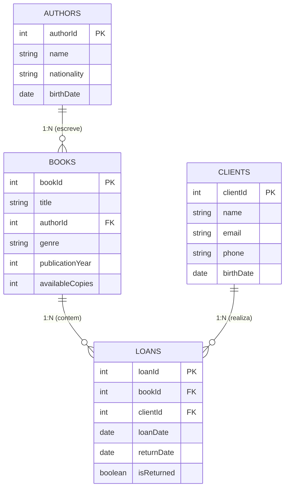
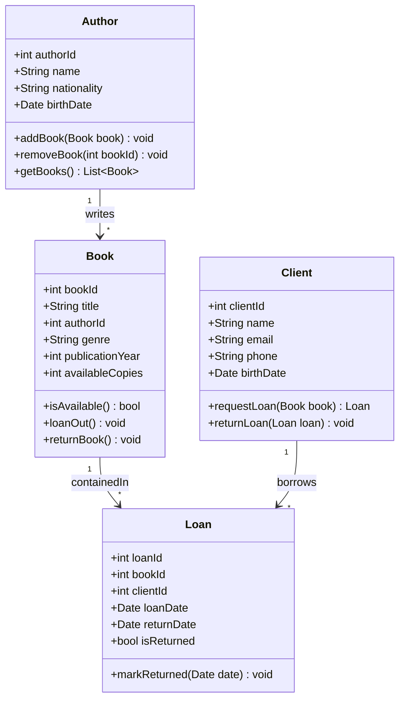

# 📚 BookStore Manager CLI


Sistema Desktop Standalone / Terminal (CLI) de alta performance para gerenciamento integrado de livraria, desenvolvido em **Node.js** com **TypeScript**, modelagem relacional completa em **PostgreSQL** e arquitetura robusta organizada em camadas baseada nos princípios de **Clean Code** e **SOLID**.

---

## 📑 Sumário

- [1. Descrição do Projeto](#1-descrição-do-projeto)
- [2. Objetivo Técnico](#2-objetivo-técnico)
- [3. Tecnologias Utilizadas](#3-tecnologias-utilizadas)
- [4. Requisitos para Execução](#4-requisitos-para-execução)
- [5. Instalação e Configuração](#5-instalação-e-configuração)
- [6. Execução da Aplicação](#6-execução-da-aplicação)
- [7. Execução do Script SQL no PostgreSQL](#7-execução-do-script-sql-no-postgresql)
- [8. Modelagem do Banco de Dados (DER e Diagrama de Classes)](#8-modelagem-do-banco-de-dados-der-e-diagrama-de-classes)
- [9. Arquitetura do Projeto](#9-arquitetura-do-projeto)
- [10. Estrutura de Pastas](#10-estrutura-de-pastas)
- [11. Funcionalidades Implementadas (RFs)](#11-funcionalidades-implementadas-rfs)
- [12. Exemplos de Utilização (Passo a Passo)](#12-exemplos-de-utilização-passo-a-passo)
- [13. Versionamento e Fluxo GitFlow](#13-versionamento-e-fluxo-gitflow)
- [14. Integrantes da Equipe & Informações do Curso](#14-integrantes-da-equipe--informações-do-curso)
- [15. Link do Kanban](#15-link-do-kanban)

---

## 1. Descrição do Projeto

O **BookStore Manager CLI** foi desenvolvido para informatizar e modernizar a gestão operacional de uma livraria, substituindo controles manuais por um sistema interativo no terminal. O sistema centraliza o controle de autores, acervo de livros, clientes e todo o ciclo de vida dos empréstimos e devoluções, garantindo integridade de dados e aplicação estrita de regras de negócio.

A aplicação opera em memória com operações assíncronas baseadas no padrão Repository, enquanto o banco de dados relacional é modelado e implementado em PostgreSQL por meio de scripts DDL, DML e relatórios gerenciais com consultas avançadas.

---

## 2. Objetivo Técnico

- Implementar uma aplicação CLI moderna, intuitiva e tipada com TypeScript e POO.
- Seguir a arquitetura em camadas com separação clara de responsabilidades (Controllers, Services, Repositories, Models, Menus, Utils).
- Programação assíncrona com `async/await` e `Promises` nas camadas de negócio e acesso a dados.
- Modelar e implementar o banco de dados relacional no PostgreSQL (tabelas, chaves primárias, chaves estrangeiras, restrições NOT NULL, UNIQUE e CHECK).
- Desenvolver relatórios gerenciais analíticos em SQL utilizando `JOIN`, `GROUP BY`, `ORDER BY`, `LIMIT` e funções de agregação.
- Garantir histórico de versionamento semântico com GitFlow e commits semânticos no GitHub.

---

## 3. Tecnologias Utilizadas

- **Linguagem:** [TypeScript](https://www.typescriptlang.org/) (v5.7+)
- **Runtime:** [Node.js](https://nodejs.org/) (v20+ / v24+)
- **Execução TS:** `ts-node`
- **Banco de Dados Relacional:** [PostgreSQL](https://www.postgresql.org/) (v14+)
- **Controle de Versão:** Git e GitHub (GitFlow)
- **Modelagem:** Diagrama Entidade-Relacionamento (DER) e Diagrama de Classes UML

---

## 4. Requisitos para Execução

Antes de executar o projeto, certifique-se de possuir instalado em sua máquina:

1. **Node.js** (versão 18.x ou superior, recomendado v20+ ou v24+)
2. **NPM** (gerenciador de pacotes incluso no Node.js)
3. **PostgreSQL** (versão 12 ou superior) ou cliente SQL (DBeaver, pgAdmin, VSCode PostgreSQL extension)
4. **Git** (para clonagem do repositório)

---

## 5. Instalação e Configuração

Clone o repositório público do GitHub e acesse o diretório do projeto:

```bash
git clone https://github.com/angeloluizdesouza/SCTEC-BookStore-Manager.git
cd SCTEC-BookStore-Manager
```

Instale as dependências do projeto:

```bash
npm install
```

---

## 6. Execução da Aplicação

### Modo Desenvolvimento (TypeScript direto via tsx)
Para iniciar a aplicação diretamente:

```bash
npm run dev
# ou
npm start
```

### Modo Produção (Compilado para JavaScript)
Para gerar a build e executar os arquivos JavaScript compilados:

```bash
npm run build
node dist/main.js
```

---

## 7. Execução do Script SQL no PostgreSQL

O arquivo SQL completo está localizado em [`database/script.sql`](./database/script.sql).

### Passos para execução no PostgreSQL (via psql):

1. Abra o terminal e conecte-se ao PostgreSQL:
   ```bash
   psql -U postgres
   ```

2. Crie a base de dados do projeto:
   ```sql
   CREATE DATABASE bookstore_db;
   \c bookstore_db
   ```

3. Execute o script completo:
   ```bash
   \i database/script.sql
   ```

### Estrutura do script SQL (`database/script.sql`):
- **Seção 1 (DDL):** Criação das tabelas `authors`, `books`, `clients` e `loans` com chaves primárias, estrangeiras e constraints (`CHECK`, `NOT NULL`, `UNIQUE`).
- **Seção 2 (DML Seed):** Carga inicial de dados idêntica à utilizada na aplicação CLI (`src/data/seed.ts`).
- **Seção 3 (DML Demonstração):** Exemplos práticos de comandos `UPDATE` e `DELETE`.
- **Seção 4 (DQL Básico):** Consultas elementares de visualização.
- **Seção 5 (DQL Relacional):** Consultas utilizando `INNER JOIN`, `LEFT JOIN`, `GROUP BY`, `ORDER BY`, `LIMIT` e agregações.
- **Seção 6 (Relatórios Gerenciais RF18):**
  1. Livros disponíveis (com estoque > 0)
  2. Livros emprestados no momento
  3. Livros cadastrados por autor com títulos agregados
  4. Quantidade de empréstimos por livro (histórico total)
  5. Clientes com empréstimos ativos e dias em posse
  6. *(Diferencial)* Ranking dos clientes mais assíduos
  7. *(Diferencial)* Tempo médio de devolução dos exemplares

---

## 8. Modelagem do Banco de Dados (DER e Diagrama de Classes)

Os diagramas originais e arquivos de modelagem estão disponíveis na pasta [`database/`](./database/).

### Diagrama Entidade-Relacionamento (DER)




### Diagrama de Classes UML




---

## 9. Arquitetura do Projeto

A aplicação foi estruturada segundo o padrão de **Arquitetura em Camadas (Layered Architecture)**, respeitando o princípio de responsabilidade única (SRP) e baixo acoplamento:

```
+-----------------------------------------------------------+
|                          MAIN.TS                          |
|         Inicialização, Seed Data & Injeção de Dep.        |
+-----------------------------------------------------------+
                              |
                              v
+-----------------------------------------------------------+
|                           MENUS                           |
|      Navegação modular no terminal (MainMenu, Submenus)    |
+-----------------------------------------------------------+
                              |
                              v
+-----------------------------------------------------------+
|                        CONTROLLERS                        |
|   Interface CLI, captura de entradas e exibição de dados  |
+-----------------------------------------------------------+
                              |
                              v
+-----------------------------------------------------------+
|                         SERVICES                          |
|    Regras de Negócio, Validações e Controle de Exceções   |
+-----------------------------------------------------------+
                              |
                              v
+-----------------------------------------------------------+
|                       REPOSITORIES                        |
|       Persistência em memória (Map/Collections assíncrono)|
+-----------------------------------------------------------+
                              |
                              v
+-----------------------------------------------------------+
|                          MODELS                           |
|      Entidades de Domínio, Classes, Interfaces e Métodos  |
+-----------------------------------------------------------+
```

- **Main (`src/main.ts`):** Ponto de entrada, instancia as dependências, popula o seed data e invoca o menu principal.
- **Controllers (`src/controllers/`):** Realizam o diálogo com o usuário no terminal, capturando dados e acionando a camada de serviços.
- **Services (`src/services/`):** Contêm todas as regras de negócio (validações de duplicidade, datas, integridade relacional, disponibilidade de estoque).
- **Repositories (`src/repositories/`):** Isolam o acesso aos dados em coleções `Map`, expondo métodos assíncronos (`async/await`) que retornam `Promises`.
- **Models (`src/models/`):** Classes e interfaces tipadas com atributos privados, getters/setters e métodos de domínio.
- **Menus (`src/menus/`):** Estruturação dos submenus para fácil navegação e extensibilidade.
- **Utils (`src/utils/`):** Formatadores de datas, estilos ANSI do console, validações e leitura segura de dados via prompt.
- **Database (`database/`):** Scripts SQL e documentação do banco de dados relacional.

---

## 10. Estrutura de Pastas

```
SCTEC-BookStore-Manager/
├── database/
│   ├── script.sql                # Script DDL, DML, Consultas e Relatórios
│   ├── Class Diagram.md          # Diagrama de Classes em Markdown Mermaid
│   ├── Class Diagram.png         # Imagem PNG do Diagrama de Classes
│   ├── ER Diagram.md             # Diagrama ER em Markdown Mermaid
│   └── ER Diagram.png            # Imagem PNG do Diagrama ER
├── src/
│   ├── controllers/
│   │   ├── AuthorController.ts   # Interação CLI para autores
│   │   ├── BookController.ts     # Interação CLI para livros
│   │   ├── ClientController.ts   # Interação CLI para clientes
│   │   ├── LoanController.ts     # Interação CLI para empréstimos/devoluções
│   │   └── index.ts
│   ├── data/
│   │   └── seed.ts               # Carga inicial de dados em memória
│   ├── menus/
│   │   ├── AuthorMenu.ts         # Submenu de autores
│   │   ├── BookMenu.ts           # Submenu de livros
│   │   ├── ClientMenu.ts         # Submenu de clientes
│   │   ├── LoanMenu.ts           # Submenu de empréstimos
│   │   ├── MainMenu.ts           # Menu principal da aplicação
│   │   └── index.ts
│   ├── models/
│   │   ├── Author.ts             # Classe e interface Author
│   │   ├── Book.ts               # Classe e interface Book
│   │   ├── Client.ts             # Classe e interface Client
│   │   ├── Loan.ts               # Classe e interface Loan
│   │   └── index.ts
│   ├── repositories/
│   │   ├── IAuthorRepository.ts  # Contrato do repositório de autores
│   │   ├── AuthorRepository.ts   # Implementação em memória
│   │   ├── IBookRepository.ts    # Contrato do repositório de livros
│   │   ├── BookRepository.ts     # Implementação em memória
│   │   ├── IClientRepository.ts  # Contrato do repositório de clientes
│   │   ├── ClientRepository.ts   # Implementação em memória
│   │   ├── ILoanRepository.ts    # Contrato do repositório de empréstimos
│   │   ├── LoanRepository.ts     # Implementação em memória
│   │   └── index.ts
│   ├── services/
│   │   ├── AuthorService.ts      # Regras de negócio de autores
│   │   ├── BookService.ts        # Regras de negócio de livros
│   │   ├── ClientService.ts      # Regras de negócio de clientes
│   │   ├── LoanService.ts        # Regras de negócio de empréstimos
│   │   └── index.ts
│   ├── utils/
│   │   ├── ConsoleUtils.ts       # Cores ANSI e formatação visual
│   │   ├── DateUtils.ts          # Manipulação e formatação de datas (DD/MM/AAAA)
│   │   ├── PromptUtils.ts        # Wrapper assíncrono para readline
│   │   ├── ValidationUtils.ts    # Validadores de e-mail, telefone, strings
│   │   └── index.ts
│   └── main.ts                   # Bootstrap da aplicação
├── .gitignore                    # Regras de exclusão do Git
├── package.json                  # Manifesto de pacotes e scripts
├── tsconfig.json                 # Configuração do compilador TypeScript
└── README.md                     # Documentação técnica completa
```

---

## 11. Funcionalidades Implementadas (RFs)

| Requisito | Descrição | Status |
|:---|:---|:---:|
| **RF01** | Configuração do projeto Node.js com TypeScript e ferramentas essenciais | Concluído |
| **RF02** | Modelagem do banco de dados relacional (DER e Diagrama de Classes) | Concluído |
| **RF03** | Estrutura DDL do PostgreSQL no arquivo `script.sql` com constraints | Concluído |
| **RF04** | Arquitetura em camadas (Controllers, Services, Repositories, Models, Menus, Utils) | Concluído |
| **RF05** | Criação das classes e interfaces com tipagem estática e modificadores | Concluído |
| **RF06** | Menu principal interativo no terminal para navegação modular | Concluído |
| **RF07** | CRUD completo de Autores (cadastrar, listar, buscar por ID, atualizar, remover) | Concluído |
| **RF08** | CRUD completo de Livros com vínculo obrigatório a um Autor existente | Concluído |
| **RF09** | CRUD completo de Clientes com validação e unicidade de e-mail | Concluído |
| **RF10** | Registro de Empréstimos com validação de estoque e impedimento de duplicatas | Concluído |
| **RF11** | Registro de Devoluções com atualização automática da disponibilidade de exemplares | Concluído |
| **RF12** | Consulta detalhada de empréstimos (ativos e histórico completo) | Concluído |
| **RF13** | Tratamento e impedimento de operações inválidas (sem crash da aplicação) | Concluído |
| **RF14** | Programação assíncrona nas camadas Services e Repositories com Promises e Async/Await | Concluído |
| **RF15** | Tratamento robusto de erros com blocos try/catch e mensagens amigáveis | Concluído |
| **RF16** | Manipulação de dados com SQL DML (INSERT, UPDATE, DELETE e SELECT) | Concluído |
| **RF17** | Consultas relacionais com `JOIN`, `GROUP BY`, `ORDER BY`, `LIMIT` e agregações | Concluído |
| **RF18** | Relatórios gerenciais analíticos em SQL no script do banco de dados | Concluído |
| **RF19** | Recursos avançados do TypeScript (interfaces, access modifiers, generics) | Concluído |
| **RF20** | Aplicação de princípios Clean Code, SOLID e nomenclatura significativa | Concluído |
| **RF21** | Bootstrap no `main.ts` com carga de seed data sincronizada | Concluído |
| **RF22** | Documentação técnica completa e detalhada no arquivo `README.md` | Concluído |

---

## 12. Exemplos de Utilização (Passo a Passo)

### 1. Inicialização
Ao rodar `npm run dev`, o sistema carrega o seed data e exibe o menu principal:

```
========================================================================
         📚  BOOKSTORE MANAGER - SISTEMA DE GESTÃO DE LIVRARIA         
========================================================================
  >> MENU PRINCIPAL <<
------------------------------------------------------------------------
 1. 🖋️  Gerenciamento de Autores
 2. 📖 Gerenciamento de Livros
 3. 👤 Gerenciamento de Clientes
 4. 🔄 Gerenciamento de Empréstimos e Devoluções
 0. 🚪 Encerrar Aplicação
------------------------------------------------------------------------
Selecione um módulo: 
```

### 2. Cadastrando um Livro
Navegue para a opção `2` (Livros) e depois `1` (Cadastrar novo livro). O sistema exibirá a lista de autores já cadastrados para você informar o ID:
```
Título do Livro: Grande Sertão: Veredas
ID do Autor: 1
Gênero Literário: Literatura Brasileira
Ano de Publicação: 1956
Quantidade de Exemplares Disponíveis [Padrão: 1]: 3
✔ [SUCESSO]: Livro "Grande Sertão: Veredas" cadastrado com sucesso! [ID: #9]
```

### 3. Realizando um Empréstimo
Navegue para a opção `4` (Empréstimos) e depois `1` (Realizar novo empréstimo):
- O sistema lista os livros com cópias disponíveis.
- Solicita o ID do livro e o ID do cliente.
- Confirma a operação e decrementa a disponibilidade do livro no acervo.

### 4. Registrando uma Devolução
Navegue para a opção `4` e selecione `2` (Registrar devolução de livro):
- O sistema lista os empréstimos ativos com o nome do livro, cliente e data de empréstimo.
- O operador informa o ID do empréstimo.
- O empréstimo é marcado como devolvido com a data atual e a quantidade de exemplares do livro é recomposta automaticamente.

---

## 13. Versionamento e Fluxo GitFlow

O projeto adota o fluxo de ramificação **GitFlow**, com commits semânticos no padrão [Conventional Commits](https://www.conventionalcommits.org/):

### Branches Utilizadas:
- `main`: Branch estável de produção.
- `develop`: Branch de integração de desenvolvimento.
- `feat/autores`: Desenvolvimento do módulo de autores.
- `feat/livros`: Desenvolvimento do módulo de livros.
- `feat/clientes`: Desenvolvimento do módulo de clientes.
- `feat/emprestimos`: Desenvolvimento do módulo de empréstimos e devoluções.
- `feat/banco-dados`: Criação do script SQL, DER e consultas relacionais.
- `docs/readme`: Elaboração da documentação técnica e diagramas.

---

## 14. Integrantes da Equipe & Informações do Curso

- **Curso:** Desenvolvedor(a) Back End Node - SCTEC
- **Turma:** 04
- **Módulo:** 01 - Semana 13 (Projeto Final Avaliativo)
- **Desenvolvedor:** Angelo Luiz de Souza
- **Repositório GitHub:** [https://github.com/angeloluizdesouza/SCTEC-BookStore-Manager](https://github.com/angeloluizdesouza/SCTEC-BookStore-Manager)

---

## 15. Link do Kanban

- **Quadro de Tarefas (Kanban / GitHub Projects):** [https://github.com/users/angeloluizdesouza/projects](https://github.com/users/angeloluizdesouza/projects) (ou quadro de acompanhamento da turma).

---

© 2026 BookStore Manager - Desenvolvido para o Curso SCTEC.
